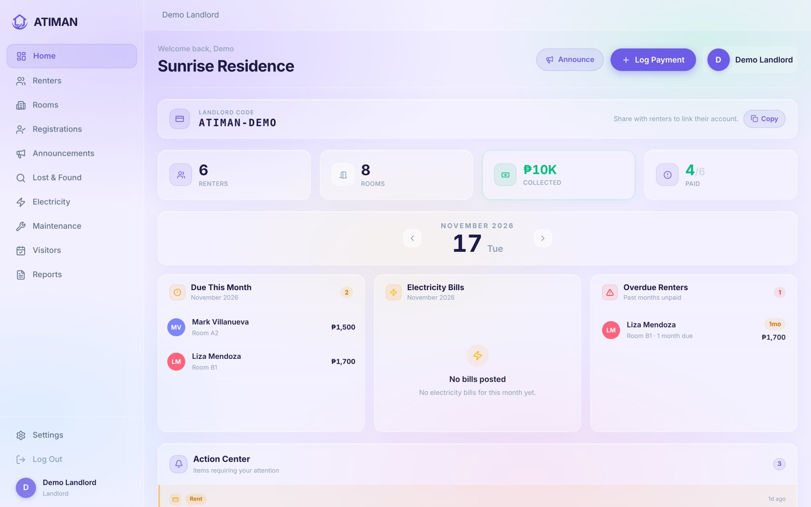
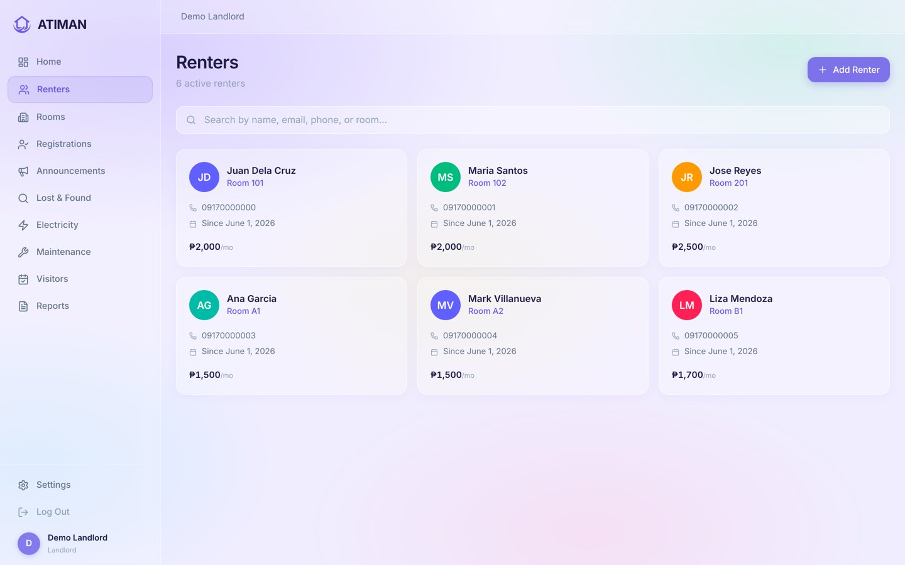
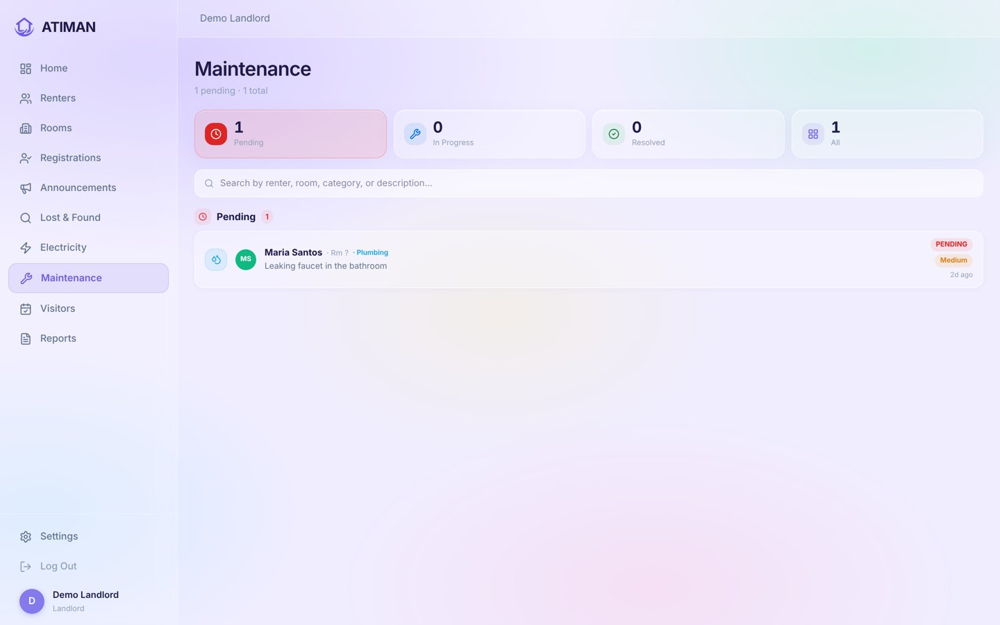
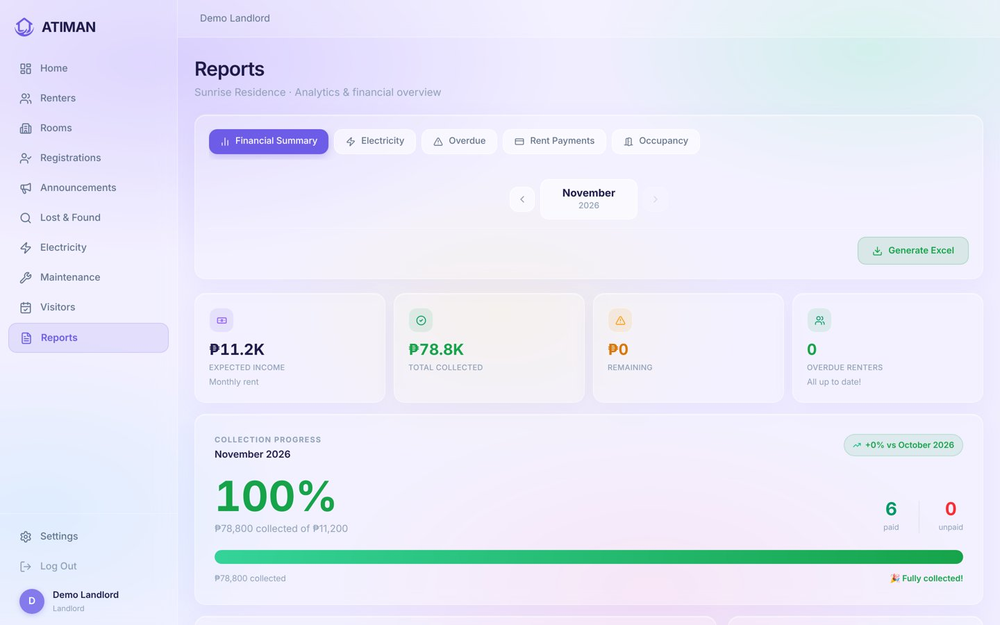
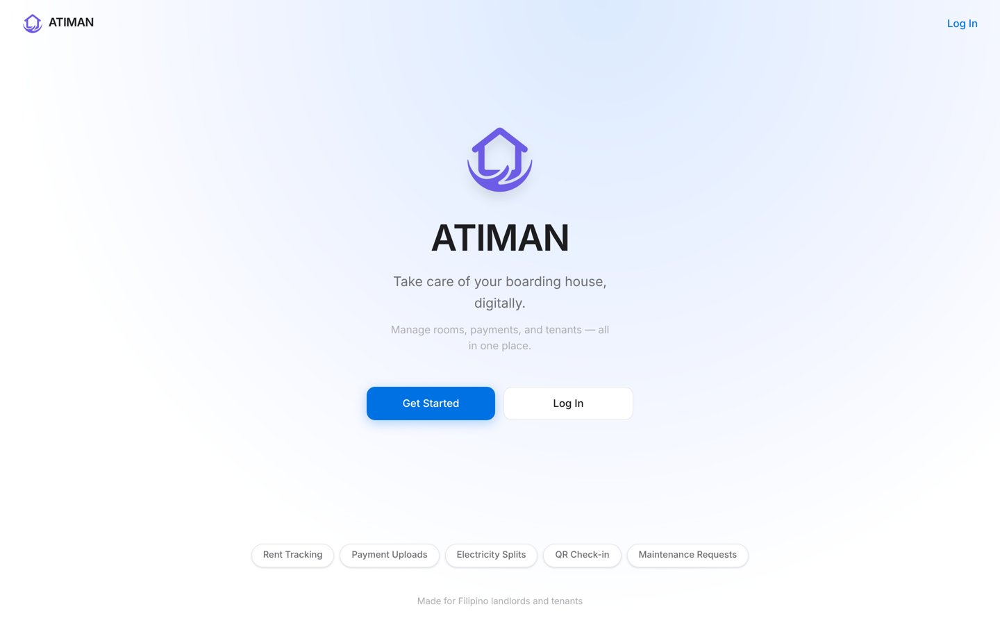
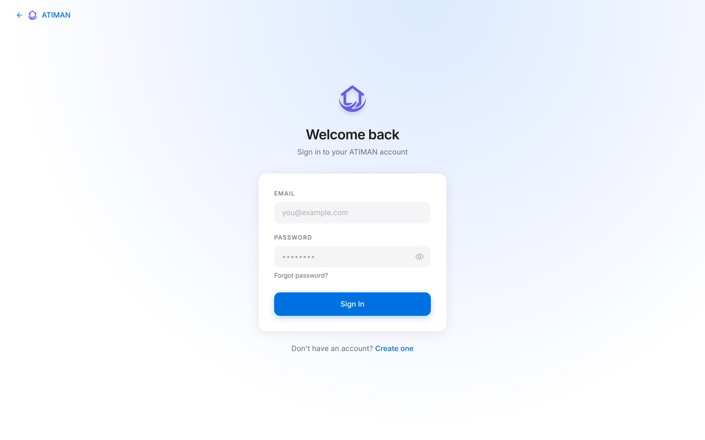
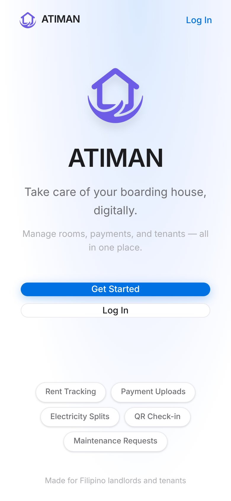

# ATIMAN: Boarding House Rent Management System

> "Atiman" is a Bisaya word meaning "to take care of."

ATIMAN is a full-stack web app that helps Filipino landlords and tenants manage boarding houses digitally. It replaces paper records, cash without receipts, and verbal agreements with one real-time, mobile-friendly platform.

## Screenshots

> Captured from the running app with sample demo data (no real tenant records).

| Landlord Dashboard | Renters |
|---|---|
|  |  |

| Maintenance Requests | Reports |
|---|---|
|  |  |

| Landing Page | Login | Mobile |
|---|---|---|
|  |  |  |

## Features

**Landlord**
- Dashboard with monthly collections, pending payments, overdue renters, and a payment calendar
- Renter registration approval using a unique landlord code
- Buildings and rooms management with occupancy and payment status
- Electricity bill splitting based on the number of occupants per room
- Maintenance tickets with status timeline, notes, and photos
- Visitor request approvals, announcements, and a Lost and Found board
- Expense tracking, profit summary, and rent forecast charts
- QR-code scanner for fast payment logging
- PDF and Excel report exports

**Renter**
- Balance and electricity share at a glance
- Upload payment receipts and track their status
- Download PDF receipts for confirmed payments
- Submit maintenance and visitor requests

## Tech Stack

| Layer | Technology |
|---|---|
| Frontend | React 18, TypeScript, Vite |
| Styling | Tailwind CSS, shadcn/ui |
| Backend and Database | Supabase (PostgreSQL) |
| Auth | Supabase Auth |
| Real-time | Supabase Realtime |
| Storage | Supabase Storage |
| Charts | Recharts |
| Exports | jsPDF, SheetJS |
| QR | qrcode.react, html5-qrcode |

## Security

- 16-table PostgreSQL database with Row Level Security (RLS) on every table
- Landlords can only access their own properties; renters can only access their own records
- Only the public anon key is used in the frontend

## Getting Started

```bash
npm install
cp .env.example .env   # then add your own Supabase URL and anon key
npm run dev
```

## Documentation

See [ATIMAN_SYSTEM_DOCUMENTATION.md](ATIMAN_SYSTEM_DOCUMENTATION.md) for the full feature list, database schema, and user flows.

## Author

Andrie Ursais, BS Computer Applications, MSU-IIT
